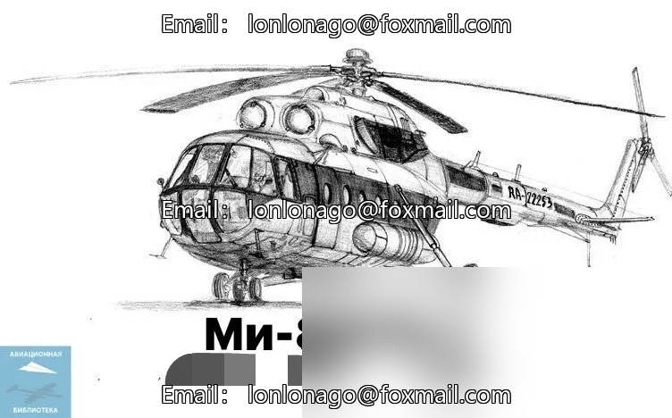
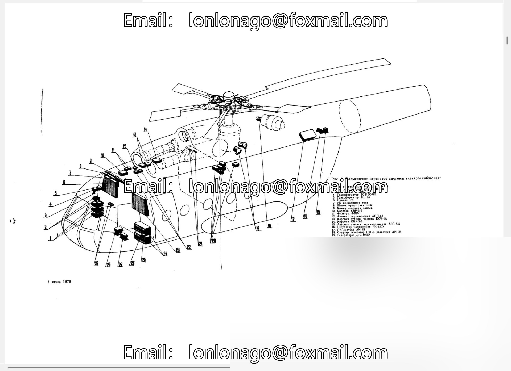
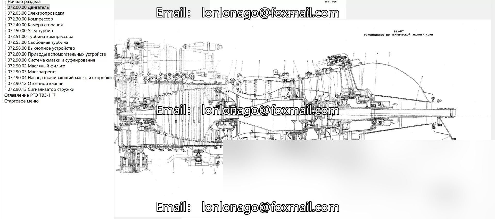

# The MIR-8 MTV-1 helicopter flight and technical operation manual. The system description, charts, and displays.

## Body

M-8MTV-1 helicopter flight and technical operation manual. System descriptions, charts, diagrams, programs, and supplementary materials.

Document list: 
1. Flight manual (FM) 
1011 pages in total for the two books. 
2. Technical maintenance regulations (TMR) 
2 parts, totaling 132 pages 
3. Technical operation manual (TOM) 
Volumes 1-5, a total of 7 volumes, 2300 pages 
4. TV3-117 engine technical operation manual 
748 pages in total for these three books 
5. VR-14 transmission technical operation manual 
96 pages in one book 
6. Parts and components catalog 
814 pages in total for the two books 
7. Feedline circuit diagram set 
2 parts, totaling 61 pages 
8. NTERAT GA-93 
161 pages in one book
Total: 19 books, 5323 pages

The manual covers system descriptions, charts, diagrams, procedures and supplementary materials, along with detailed material lists and total page counts.

<!-- AI_ENRICHED -->

## Images

## Payment

Here is a pay link on Stripe ( https://buy.stripe.com/3cs8yP7sY87d0vu9AB ). Please contact me lonlonago@foxmail.com after funding $89, and I will send you a complete data files , thank you!

